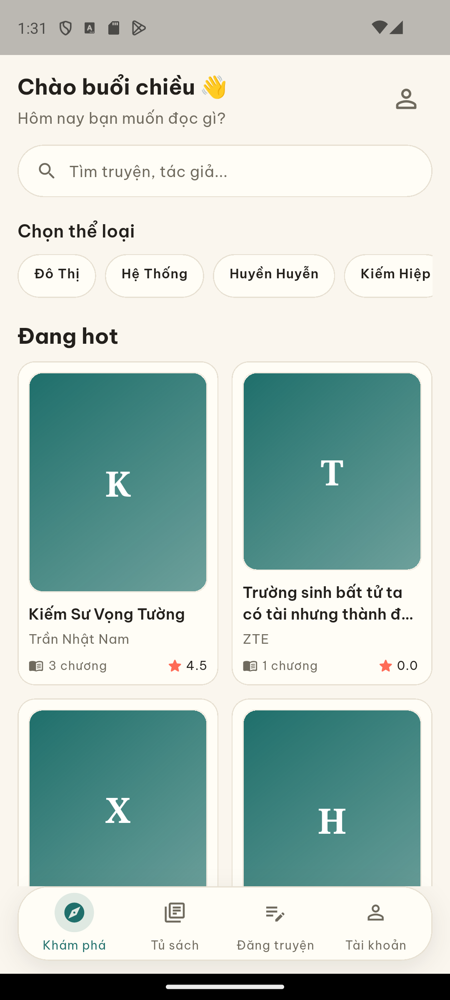
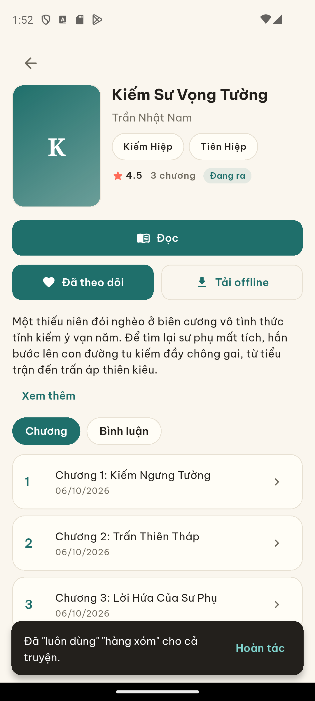
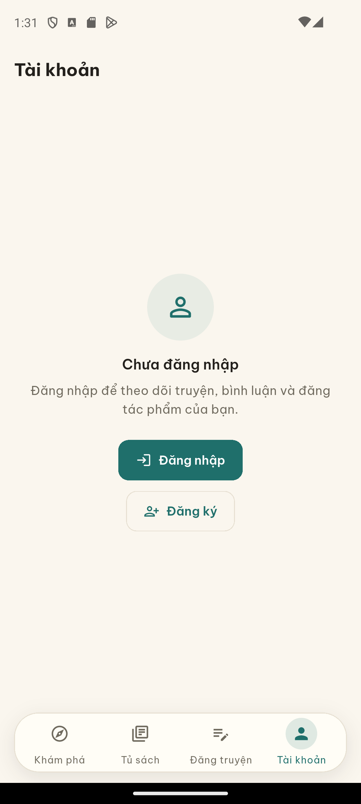
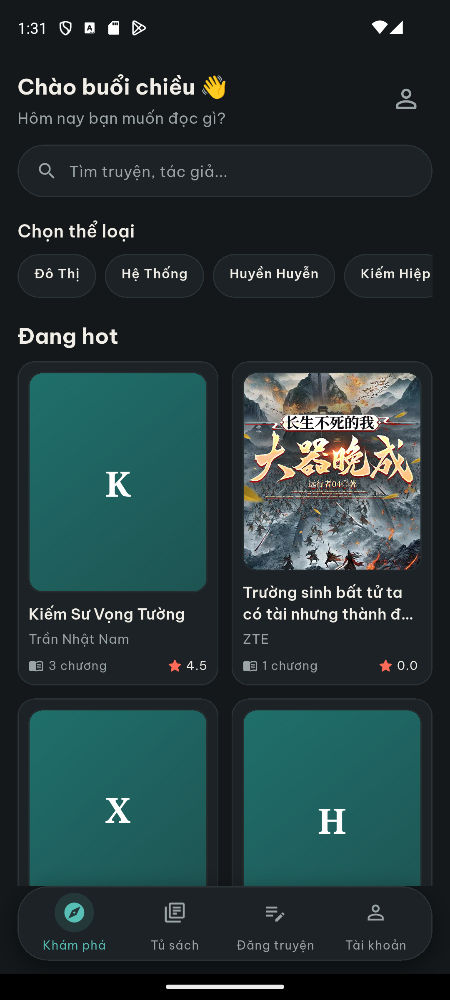
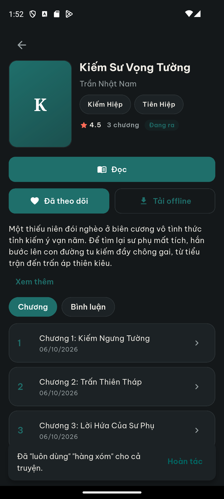
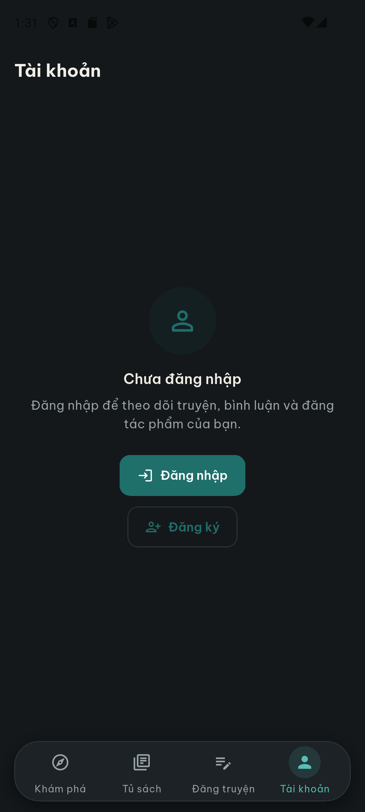
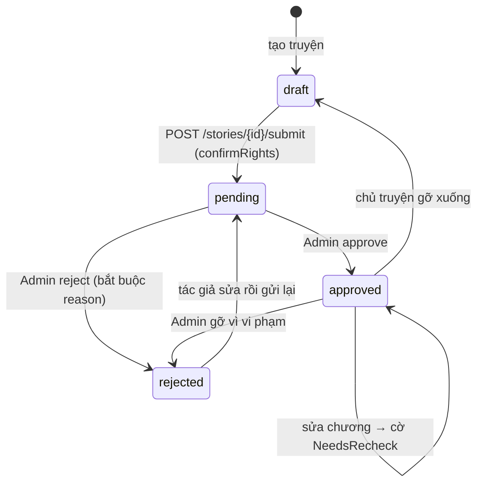

# VietRead — Đọc & đăng truyện chữ

Ứng dụng **đọc và đăng truyện chữ** cho Android viết bằng **Flutter**, kèm backend REST **FastAPI + SQL Server**.
Người đọc tìm kiếm, theo dõi, tải truyện về máy để đọc ngoại tuyến; người đăng tạo truyện rồi **gửi Admin kiểm duyệt** —
truyện chỉ hiện công khai sau khi được duyệt. Dịch Trung → Việt chạy bằng **từ điển offline** ngay trên backend.

Đặc tả đề bài: [VietRead_prompt.md](VietRead_prompt.md) · Nhật ký phát triển: [docs/CHANGELOG-BUOC.md](docs/CHANGELOG-BUOC.md)

**Trạng thái (11/2026):** backend và app **chạy thật trên máy phát triển** — đã dựng database SQL Server, chạy
`uvicorn` + Swagger, build APK và chạy test thành công (xem [Kiểm thử](#kiểm-thử)). Luồng đăng truyện → gửi duyệt →
Admin duyệt/từ chối, nhập truyện từ link, dịch từ điển và kiểm quyền đều chạy thật. Backend đưa ra Internet được bằng
**Cloudflare Tunnel** (URL tạm `*.trycloudflare.com` — xem [đưa backend ra Internet](#đưa-backend-ra-internet--cloudflare-tunnel)),
nhưng **chưa** deploy chính thức (chưa có CI/Docker, chưa có tên miền cố định, backend mặc định chỉ nghe `127.0.0.1`),
**chưa** có logic quét nội dung tự động (cột `ScanStatus` đã có trong schema nhưng chưa ai ghi), và nguồn nhập mới chỉ
có **Qidian** + nguồn demo.

## Ảnh chụp màn hình

|  |  |  |
|---|---|---|
| *Khám phá — chế độ sáng, 4 tab điều hướng* | *Chi tiết truyện — đọc, theo dõi, tải offline* | *Tài khoản — đăng nhập, truyện của tôi* |
|  |  |  |
| *Khám phá — chế độ tối* | *Chi tiết truyện — chế độ tối* | *Tài khoản — chế độ tối* |

## Tính năng

### Đã hoạt động

| Nhóm | Tính năng |
|---|---|
| Đọc truyện | Nền Sáng · Tối · Sepia, font Serif/Sans, cỡ chữ, giãn dòng; tự lưu tiến độ → thẻ "Đọc tiếp" + % |
| Tìm kiếm | Tìm theo tên truyện / tác giả nguyên tác, lọc thể loại · trạng thái, nhiều kiểu sắp xếp |
| Tủ sách | Theo dõi, lịch sử đọc, **tải offline** (SQLite) và đọc khi mất mạng; **bình luận** theo truyện hoặc chương |
| Đăng nội dung | Tạo/sửa/xoá truyện & chương, nháp → gửi duyệt → Admin duyệt; tìm & thay thế theo truyện (có hoàn tác) |
| Nhập truyện | Nhập từ link **Qidian** chạy nền (`Pending → Running → Done/Failed`) và **nguồn demo** không cần mạng; thêm chương từ link hoặc dán văn bản, có chống trùng |
| Dịch thuật | Dịch Trung → Việt bằng từ điển offline, gợi ý nhiều nghĩa (marker `{nghĩa1\|nghĩa2}`), dịch lại và dọn marker cho người đăng |
| Kiểm duyệt | Danh sách chờ duyệt, xem trước chương, duyệt / từ chối kèm lý do, cờ "Cần xem lại" khi tác giả sửa chương đã duyệt |
| Tài khoản | Đăng ký / đăng nhập JWT, phân quyền `user` · `admin` |

### Chưa triển khai

| Hạng mục | Thực tế trong code |
|---|---|
| Deploy chính thức | Chưa có CI, Dockerfile hay cấu hình máy chủ; backend mặc định nghe `127.0.0.1:8000` |
| Quét nội dung tự động | Cột `ScanStatus` / `ScanSummary` có trong `schema.sql` nhưng **chưa có logic quét** (schema ghi rõ) — app chỉ ẩn khối kết quả quét |
| Nguồn truyện ngoài Qidian | `backend/app/services/scraper.py` chỉ có adapter Qidian + nguồn demo `demo.vietread.local` |
| Upload ảnh bìa / avatar | Không có endpoint nhận file; `coverUrl`, `avatarUrl` chỉ là **URL** (`max_length=500`) |
| Đồng bộ tiến độ đọc | Tiến độ, cài đặt đọc và bản tải nằm **riêng trên từng máy** — server không lưu |
| Ký bản phát hành | `android/app/build.gradle.kts` đang ký release bằng **debug keystore** |

## Kiến trúc

```
   App Flutter (Android) — lib/
   screens · services · widgets
   SQLite + shared_prefs  (dữ liệu ngoại tuyến)   │  REST/JSON · JWT Bearer · API_BASE_URL (10.0.2.2 / IP LAN / adb reverse / tunnel)
               ▼
   FastAPI — backend/app   (uvicorn, cổng 8000)
   ├── routers/ (53 route)  →  services/  →  SQLAlchemy
   ├── import_worker  ← BackgroundTasks    job nhập link chạy nền
   ├── scraper        ← Qidian / nguồn demo
   └── translator     ← backend/dictionaries/   từ điển offline
               │  pyodbc + ODBC Driver 18 for SQL Server
               ▼
   ┌ SQL Server — database VietRead ┐   ┌ Trên điện thoại (ngoại tuyến) ┐
   │ 16 bảng → nguồn dữ liệu chính  │   │ SQLite: bản tải, lịch sử đọc  │
   │ Stories, Chapters, Comments,    │   │ shared_prefs: tiến độ, cài đặt │
   │ ImportJobs, ModerationLog…      │   │ → KHÔNG đồng bộ giữa các máy   │
   └────────────────────────────────┘   └────────────────────────────────┘
```

- **Server là nguồn quyết định**: quyền chủ truyện (`author_id`), trạng thái kiểm duyệt và việc truyện có công khai không — app chỉ gửi yêu cầu, không tự đổi trạng thái được.
- Mọi chuyển trạng thái đi qua `backend/app/moderation.py`: sai → **409**, `IsDraft` luôn đồng bộ với `ModerationStatus` trong cùng transaction.
- Job nhập link do **backend chạy nền** (FastAPI `BackgroundTasks`); app chỉ tạo job rồi poll trạng thái.
- Backend trả chương **đã resolve marker**; bản thô (`?raw=1`) chỉ chủ truyện xem được.

## Công nghệ

| Thành phần | Dùng gì |
|---|---|
| App | Flutter (Dart SDK `^3.13.3` — [pubspec.yaml](pubspec.yaml)): `http`, `sqflite`, `shared_preferences`, `path_provider`, `cached_network_image` |
| Backend | FastAPI, SQLAlchemy, pyodbc, JWT (`python-jose`) + bcrypt qua passlib — [requirements.txt](backend/requirements.txt) |
| Database | SQL Server (ODBC Driver 18), 16 bảng; **SQLite** trên máy cho đọc ngoại tuyến |
| Từ điển | Bộ offline trong [backend/dictionaries/](backend/dictionaries/README.md) (`vietphrase.txt`, `names.txt`, `hanviet.txt`…) |
| Kiểm thử | `flutter test` · `flutter analyze` · 6 script Python trong `backend/` |

## Cấu trúc thư mục

```
lib/
  main.dart        # MaterialApp: theme sáng/tối, locale vi
  models/          # story, chapter, comment, import_job, moderation, reading_progress…
  services/        # api_config, api_service, auth_service, db_helper (SQLite), offline_service, prefs_service
  screens/         # home, story_detail, reader, library, upload, import, search, replace, moderation, profile, auth
  widgets/ theme/  # floating_nav, skeleton, empty_state · app_theme, app_spacing
assets/fonts/      # Be Vietnam Pro + Noto Serif
test/              # 179 test widget/service
backend/
  app/             # main.py, models, schemas, security, moderation.py
    routers/       # auth, stories, chapters, imports, admin… (53 route)
    services/      # import_worker, scraper, translator, glossary, story_words
  database/        # schema.sql, seed.sql, 7 file migrate_*.sql
  dictionaries/    # dữ liệu dịch offline (vietphrase.txt kèm trong repo)
  test_*.py        # 6 script test backend   |  tools/create_admin.py
docs/              # API.md · DATABASE.md · TRANSLATION.md · DEPLOY.md · CONTRIBUTING.md · CHANGELOG-BUOC.md · screenshots/
```

## Bắt đầu nhanh

**Yêu cầu:** Flutter 3.x · Python 3.10+ · SQL Server (Express/Developer) · [ODBC Driver 18](https://learn.microsoft.com/sql/connect/odbc/download-odbc-driver-for-sql-server)

**1. Lấy mã nguồn** — rồi làm tiếp theo từng bước:

```powershell
git clone https://github.com/htltri9-byte/VietRead.git
cd VietRead
```

**2. Tạo database** — trong `backend\` (SSMS: mở `database\schema.sql` → F5, rồi `seed.sql` → F5, hoặc dùng sqlcmd)

```powershell
sqlcmd -S localhost -E -C -b -f 65001 -i database/schema.sql
sqlcmd -S localhost -E -C -b -f 65001 -i database/seed.sql
```

DB tạo từ bản cũ thì chạy thêm migration (đều idempotent, chạy lại an toàn): `migrate_source_tracking.sql`, `migrate_original_author.sql`, `migrate_glossary_revisions.sql`, `migrate_dictionary_words.sql`, `migrate_story_words.sql`, `migrate_moderation.sql`, `migrate_learn_rules.sql`.

**3. Cấu hình backend**

```powershell
cd backend
copy .env.example .env        # Linux/macOS: cp .env.example .env
```

Điền giá trị của bạn vào `.env` (xem [Cấu hình và bí mật](#cấu hình-và-bí-mật)).

**4. Chạy backend** — vẫn ở trong `backend\`:

```powershell
python -m venv .venv
.venv\Scripts\Activate.ps1     # Linux/macOS: source .venv/bin/activate
pip install -r requirements.txt
.venv\Scripts\python.exe -m uvicorn app.main:app --reload --host 127.0.0.1 --port 8000
```

Kiểm tra DB: <http://127.0.0.1:8000/health> → `{"status":"ok","database":"connected"}` · Swagger: <http://127.0.0.1:8000/docs>

**5. Chạy app Flutter**

```powershell
flutter pub get
flutter run                 # thêm --dart-define=API_BASE_URL=... như mục 6
```

**6. `API_BASE_URL`**

| Chỗ chạy app | Giá trị |
|---|---|
| Emulator Android (mặc định) | `http://10.0.2.2:8000` |
| Máy thật, cùng mạng WiFi | IP LAN của máy chạy backend, ví dụ `http://192.168.1.10:8000` |
| Máy thật, cáp USB | `adb reverse tcp:8000 tcp:8000` rồi đặt `http://127.0.0.1:8000` |
| Máy thật, qua Internet | URL tunnel `https://<tên>.trycloudflare.com` (xem dưới) |

Ghi đè bằng `flutter run --dart-define=API_BASE_URL=...` ([api_config.dart](lib/services/api_config.dart)) · chi tiết máy thật, bảo mật: [docs/DEPLOY.md](docs/DEPLOY.md).

### Đưa backend ra Internet — Cloudflare Tunnel

Không mở port router, không cần IP tĩnh (chi tiết: [docs/DEPLOY.md](docs/DEPLOY.md) mục 4):

```powershell
# cài một lần: winget install Cloudflare.cloudflared
cloudflared tunnel --url http://localhost:8000     # backend vẫn chạy 127.0.0.1:8000 như bình thường
```

Log sẽ in URL dạng `https://xxx-yyy.trycloudflare.com` — dùng đúng URL đó làm `API_BASE_URL` khi build app. Tunnel có
HTTPS sẵn nên thỏa yêu cầu Android về `http://`.

> **Lưu ý:** URL của tunnel tạm **đổi mỗi lần chạy lại lệnh** — APK build bằng URL cũ sẽ gọi không được nữa nên phải lấy
> URL mới rồi build lại. Tunnel không có uptime guarantee, chỉ để demo/test; muốn domain cố định thì
> `cloudflared tunnel create vietread` + `cloudflared tunnel route dns vietread example.com` rồi cấu hình `config.yml`.

**7. Tài khoản thử nghiệm** — do `backend/database/seed.sql` tạo, **mật khẩu nằm trong file seed** (chỉ cho phát triển):

| Email | Vai trò |
|---|---|
| `tacgia@vietread.vn` | tác giả (có truyện mẫu) |
| `docgia@vietread.vn` | độc giả (theo dõi + bình luận) |
| `admin@vietread.vn` | **admin** kiểm duyệt |

Tạo admin thật bằng `backend/tools/create_admin.py` và **đổi mật khẩu mẫu** trước khi mở backend ra internet. Lệnh
nhận tham số **vị trí** (không phải cờ `--email`/`--password`):

```powershell
cd backend
.venv\Scripts\python.exe tools/create_admin.py admin@vietread.vn '<MAT_KHAU_MANH>'
```

Chạy lại với email đã có sẽ **cập nhật** mật khẩu (và `role = admin`), không tạo trùng. Mật khẩu admin trên máy phát
triển hiện **khác** mật khẩu trong `seed.sql` (đã đặt lại bằng lệnh trên) → `test_api.py` hardcode `VietRead@123` cho
admin sẽ dừng ở bước đăng nhập, xem [Xử lý sự cố](#xử-lý-sự-cố).

## Cấu hình và bí mật

**Không commit** (đã có trong `.gitignore`): `backend/.env`, `backend/.venv/`, `backend/dictionaries/_cache.pkl`, `.dart_tool/`, `build/`, `*.log`, bản sao lưu database.

| Biến trong `backend/.env` | Ý nghĩa |
|---|---|
| `DATABASE_URL` | Chuỗi nối SQL Server — 2 cách trong `.env.example` (Windows Authentication hoặc SQL Auth) |
| `SECRET_KEY` · `ALGORITHM` | Chuỗi ký JWT (phải ngẫu nhiên) · thuật toán, mặc định `HS256` |
| `ACCESS_TOKEN_EXPIRE_MINUTES` | Thời hạn token — mặc định `10080` (7 ngày) |
| `CORS_ORIGINS` | Origin được phép gọi API, phân tách dấu phẩy — mặc định `*`; máy này **vẫn đang đặt `*`** → phải đổi thành danh sách origin cụ thể trước để backend truy cập công khai |
| `TRANSLATE_MODE` · `TRANSLATE_API_KEY` · `TRANSLATE_API_URL` | Chế độ dịch `dict`/`online`/`auto` + khoá/endpoint dự phòng (để trống vẫn chạy) |
| `IMPORT_CHAPTER_DELAY` · `IMPORT_MAX_CHAPTERS` | Delay giữa các request nhập chương (giây) · giới hạn số chương mỗi job |
| `MARK_LEVEL` · `LEARN_SKIP_THRESHOLD` | Mức marker `low`/`medium`/`high` · số lượt "Không hỏi lại" trước khi khoá (`<=0` = tắt) |

**Nếu lộ key:** đổi `SECRET_KEY` ngay (mọi token cũ hết hiệu lực, người dùng phải đăng nhập lại), đổi mật khẩu database nếu `DATABASE_URL` bị lộ, xoá key khỏi lịch sử git, và kiểm tra `.env` không lọt vào thư mục build.

## Luồng chính

### 1. Vòng đời kiểm duyệt truyện

Truyện mới tạo thường ở **nháp**; người đăng bổ sung chương rồi bấm "Gửi duyệt" — backend yêu cầu đủ điều kiện
(≥1 chương, có tên/mô tả/thể loại) **và** body `{ "confirmRights": true }`. Admin xem trước (kể cả khi chưa công khai),
rồi **Duyệt** hoặc **Từ chối kèm lý do** (5–1000 ký tự). Truyện đã duyệt mà tác giả sửa/chèn/xoá chương thì tự đặt cờ
**"Cần xem lại"**; Admin duyệt lại để bỏ cờ. Chuyển trạng thái sai trả **409**, hai Admin cùng lúc an toàn (UPDATE có
điều kiện trong transaction).



### 2. Nhập truyện từ link Qidian

App gửi `POST /imports` → backend tạo job **Pending**, trả `{ jobId }` và chạy nền bằng `BackgroundTasks`. Worker
chuyển **Running**, cào danh mục qua adapter Qidian (link desktop tự rewrite về `m.qidian.com`), tạo truyện **nháp**
thuộc người tạo job, rồi cào và dịch từng chương theo `IMPORT_CHAPTER_DELAY` — mỗi chương xong `progress` tăng, xong
hết → **Done** (100). Lỗi (nguồn chặn HTTP 403, chương trả phí VIP, link sai, lỗi dịch) → **Failed** kèm `Error` tiếng
Việt. App poll `GET /imports/{jobId}` — chỉ chủ job xem được.

### 3. Dịch từ điển và marker nghĩa

Backend dịch theo thứ tự `names.txt → luatnhan.txt → vietphrase.txt → surnames.txt → hanviet.txt`. Từ nhiều nghĩa được
giữ dưới dạng marker `{中文|nghĩa1|nghĩa2}` khi lưu; khi trả chương backend **resolve** thành danh sách nghĩa để người
đọc chọn "Luôn dùng" / "Không hỏi lại". Lựa chọn ghi vào `StoryWordChoices` / `UserMarkRules` nên lần sau không hỏi
lại; người đăng dùng `POST /stories/{id}/markers/clean` để dọn chữ Hán còn sót trong marker.

## API

Tổng **53 route** (51 endpoint nghiệp vụ + `/` + `/health`). Bảng đầy đủ: [docs/API.md](docs/API.md) · test tương tác: <http://127.0.0.1:8000/docs>

| Nhóm | Method | Đường dẫn | Quyền | Mô tả |
|---|---|---|---|---|
| Meta | GET | `/health` | Công khai | Kiểm tra kết nối SQL Server (200 / 503) |
| Xác thực & hồ sơ | POST / GET | `/auth/register`, `/auth/login`, `/auth/me` | Công khai / Đăng nhập | Lấy `{ token, user }`; `/auth/me` trả user kèm `role` |
| Truyện | GET | `/stories`, `/me/stories` | Công khai / Đăng nhập | Truyện đã duyệt · truyện của mình (kể cả nháp) |
| Truyện | POST | `/stories/{id}/submit`, `/stories/{id}/unpublish` | Chủ truyện | Gửi duyệt · gỡ về nháp |
| Chương | GET / POST/PUT/DELETE | `/chapters/{id}`, `/stories/{id}/chapters` | Công khai / Chủ truyện | Nội dung (đã resolve marker, `?raw=1` bản thô) · thêm/sửa/xoá; sửa chương đã duyệt → cờ cần xem lại |
| Nhập link & thêm chương | POST / GET | `/imports`, `/imports/{jobId}`, `/stories/{id}/chapters/import`, `/import-text` | Đăng nhập / Chủ truyện | Tạo job chạy nền · poll `Pending/Running/Done/Failed` + % · thêm chương từ link hoặc dán văn bản |
| Tìm & thay thế | POST / GET/DELETE | `/stories/{id}/replace`, `/replace/undo`, `/glossary`, `/word-choices`, `/ignored-words` | Chủ truyện | Thay text (có `dryRun`), hoàn tác batch, quy tắc, nghĩa "luôn dùng", từ "không hỏi lại" |
| Bình luận & theo dõi | POST/DELETE | `/follows/{storyId}`, `/me/follows`, `/stories/{id}/comments`, `/comments/{id}` | Đăng nhập | Theo dõi / bình luận |
| Dịch & từ điển | POST/GET/DELETE | `/dictionary/names`, `/dictionary/mark-lists/reload` | Đăng nhập | Từ Trung → Việt của mình, nạp lại marker |
| Kiểm duyệt (Admin) | GET / POST | `/admin/stories`, `/admin/stories/{id}`, `/admin/stats`, `approve`, `reject` | Admin | Lọc theo trạng thái, xem trước, số liệu · duyệt / từ chối (bắt buộc `reason`) |

Quy ước: lỗi luôn trả `{ "message": "..." }`; cần đăng nhập thì gửi `Authorization: Bearer <token>`; chỉ truyện `approved` mới hiện với người đọc — truyện chưa duyệt trả **404** (chủ truyện và Admin vẫn xem được).

## Dữ liệu và sao lưu

**SQL Server — nguồn dữ liệu chính:** tài khoản, truyện, chương, bình luận, theo dõi, job nhập, kiểm duyệt.

- **SSMS:** chuột phải database `VietRead` → Tasks → Back Up… → thêm đường dẫn `.bak` → OK.
- **Lệnh** (thay `D:\Backup` bằng thư mục của bạn) — repo chưa có script sao lưu tự động nên chạy tay định kỳ:

```sql
BACKUP DATABASE VietRead TO DISK = N'D:\Backup\VietRead.bak' WITH INIT, FORMAT;
-- Khôi phục:
RESTORE DATABASE VietRead FROM DISK = N'D:\Backup\VietRead.bak' WITH REPLACE;
```

**SQLite trên điện thoại:** bản tải và lịch sử đọc (`downloaded_stories`, `downloaded_chapters`, `reading_history`)
chỉ nằm trên máy đó — xoá app là mất.

**Không đồng bộ giữa các máy thành viên:** tiến độ đọc + cài đặt đọc (font, nền, cỡ chữ) nằm trong
`shared_preferences`, bản tải và lịch sử nằm trong SQLite. Muốn dùng chung thì mọi người trỏ vào **cùng một backend**
— chỉ dữ liệu server (truyện đã duyệt, bình luận, theo dõi, từ điển người dùng) là dùng chung.

## Kiểm thử

Số liệu lấy từ lần chạy thật trên máy này:

```powershell
flutter analyze              # 0 issue
flutter test                 # 179 test — All tests passed

cd backend
# không cần server:
.venv\Scripts\python.exe test_moderation.py       # 89 kiểm tra
.venv\Scripts\python.exe test_marking.py          # 80 kiểm tra
.venv\Scripts\python.exe test_alternatives.py     # 55 kiểm tra
.venv\Scripts\python.exe test_golden_translate.py # 10 kiểm tra
.venv\Scripts\python.exe test_offline.py          # 12 kiểm tra → tổng 246 PASS
# cần server đang chạy cổng 8000:
.venv\Scripts\python.exe test_api.py
```

Linux/macOS: dùng `.venv/bin/python`. Windows chạy qua pipe bị `UnicodeEncodeError` thì thêm `PYTHONUTF8=1`.

`test_api.py` **cần server đang chạy** và tài khoản đúng như seed. Lần chạy gần nhất: 36 kiểm tra đầu pass rồi **dừng ở
bước đăng nhập `admin@vietread.vn`** — script hardcode mật khẩu `VietRead@123` cho admin, trong khi mật khẩu admin trên
máy đã được đặt lại bằng `create_admin.py` (seed chỉ thêm khi email chưa có, chạy lại không ghi đè). Cách xử lý: xem
mục [Xử lý sự cố](#xử-lý-sự-cố).

## Build APK

```powershell
flutter build apk --release --dart-define=API_BASE_URL=http://<IP_MAY_CHAY_BACKEND>:8000
```

Kết quả: `build\app\outputs\flutter-apk\app-release.apk` — lần build thật trên máy này: **55.4MB**, khoảng 254 giây.

- **Đang ký bằng debug keystore** (`android/app/build.gradle.kts` → `signingConfig = signingConfigs.getByName("debug")`)
  nên cài đặt được nhưng **chưa nên phát hành**.
- Trước khi phát hành: tạo keystore riêng (`keytool -genkey -v -keystore release.jks -keyalg RSA -keysize 2048 -validity 1000 -alias vietread`), khai báo `signingConfigs.release` trong `build.gradle.kts`, **không** commit keystore / mật khẩu keystore.
- `API_BASE_URL` được nén vào lúc build — đổi máy chủ là phải build lại.

## Bảo mật

| Hạng mục | Code đang làm |
|---|---|
| Mật khẩu | Băm bằng **bcrypt** qua passlib (`CryptContext(schemes=["bcrypt"])`) — không lưu mật khẩu gốc |
| JWT | Ký `HS256` bằng `SECRET_KEY` từ env, hạn theo `ACCESS_TOKEN_EXPIRE_MINUTES`; thiếu/sai token → 401 |
| Phân quyền | `role = user/admin`: endpoint `/admin/*` yêu cầu admin (chưa đăng nhập 401, người thường 403) |
| Quyền chủ truyện | Sửa/xoá kiểm `author_id` với user trong token: khác → 403, không tồn tại → 404 |
| Kiểm duyệt | Trạng thái chỉ đổi theo `VALID_TRANSITIONS` trong `moderation.py`; sai → 409 |
| Validate đầu vào | Pydantic `Field(min_length/max_length)` cho tên, email, mật khẩu (≥6), tiêu đề, `coverUrl` ≤500 |
| Upload file | **Không có** endpoint nhận file — bìa/avatar là URL string |
| CORS | `CORSMiddleware` với `CORS_ORIGINS` từ env — hiện vẫn là `*` trong `.env`, phải thu hẹp khi backend truy cập công khai ([docs/DEPLOY.md](docs/DEPLOY.md) mục 5) |

## Giới hạn hiện tại

- **Chưa deploy chính thức:** chỉ đưa ra Internet bằng Cloudflare Tunnel tạm (`*.trycloudflare.com`, đổi URL mỗi lần chạy lại, không có uptime guarantee) — chưa có CI/Docker, backend mặc định chỉ nghe `127.0.0.1`, chưa có tên miền.
- **Chỉ nhập từ Qidian** (kèm nguồn demo) — nguồn khác phải tự viết adapter trong `backend/app/services/scraper.py`.
- **Chất lượng dịch là kiểu tra từ điển (convert):** phụ thuộc bộ `vietphrase.txt` (kèm trong repo); cụm không có trong từ điển sẽ rơi về **âm Hán-Việt từng chữ**, câu chưa tự nhiên như dịch máy.
- **Cào có thể bị chặn:** Qidian chặn bot/IP (`HTTP 403`), chương trả phí VIP không lấy được → job `Failed`.
- **Dữ liệu mỗi máy riêng:** tiến độ đọc, cài đặt và bản tải không đồng bộ giữa các máy thành viên.
- **Chưa quét nội dung tự động:** schema đã chuẩn bị cột nhưng chưa có logic; Admin duyệt hoàn toàn thủ công.
- **Chưa đổi cách ký APK** — bản release hiện vẫn ký bằng debug keystore.

## Xử lý sự cố

| Hiện tượng | Cách xử lý |
|---|---|
| Uvicorn báo `[Errno 10048] … [winerror 10048] only one usage of each socket address` | Cổng 8000 đã có tiến trình cũ: `netstat -ano \| findstr :8000` → lấy PID ở cột cuối → `taskkill /PID <PID> /F` rồi chạy lại |
| Sửa code backend nhưng request vẫn trả kết quả cũ | Chạy uvicorn kèm `--reload`; nếu đang chạy không có `--reload` thì Ctrl+C rồi chạy lại |
| App báo không kết nối / timeout | (1) backend chưa chạy → mở `/health`; (2) máy thật chưa chạy `adb reverse tcp:8000 tcp:8000`; (3) `API_BASE_URL` sai IP; (4) Android 9+ chặn HTTP → `AndroidManifest.xml` phải giữ `android:usesCleartextTraffic="true"` |
| `/health` trả `503` | Service SQL Server dừng → `services.msc` → bật SQL Server (MSSQLSERVER) |
| `Can't open lib 'ODBC Driver 18 for SQL Server'` | Chưa cài driver hoặc sai tên trong `DATABASE_URL` → cài [ODBC Driver 18](https://learn.microsoft.com/sql/connect/odbc/download-odbc-driver-for-sql-server), kiểm tra `python -c "import pyodbc; print(pyodbc.drivers())"` |
| Log `Thiếu vietphrase.txt — đang dịch CHỈ theo âm Hán-Việt từng chữ` | File bị xoá/đổi tên → `git checkout backend/dictionaries/vietphrase.txt`, xoá `_cache.pkl` rồi restart backend |
| Nhập link Qidian báo `Failed` (nguồn chặn / chương trả phí VIP) | Đọc `Error` trong `GET /imports/{jobId}`; đổi sang chương thường, hoặc dùng nguồn demo `demo.vietread.local` để test luồng |
| `test_api.py` dừng ở bước đăng nhập admin | Mật khẩu admin khác giá trị hardcode trong `test_api.py` → đặt lại bằng `.venv\Scripts\python.exe tools/create_admin.py admin@vietread.vn '<mật khẩu>'` (ghi đè hash, giữ `role = admin`), hoặc sửa cho khớp mật khẩu đang dùng. Chạy lại `seed.sql` **không** có tác dụng vì seed chỉ thêm khi email chưa tồn tại |
| Đổi máy / cài lại app thì mất tiến độ đọc | Tiến độ, cài đặt và bản tải lưu **local** (shared_preferences + SQLite), không tự đồng bộ — phải đọc lại hoặc sao lưu thủ công |

## Tài liệu

[docs/API.md](docs/API.md) (endpoint & quyền) · [docs/DATABASE.md](docs/DATABASE.md) (16 bảng, quan hệ, migration) · [docs/TRANSLATION.md](docs/TRANSLATION.md) (dịch, marker) · [docs/DEPLOY.md](docs/DEPLOY.md) (máy thật, tunnel, bảo mật) · [docs/CONTRIBUTING.md](docs/CONTRIBUTING.md) (nhánh, commit, PR) · [docs/CHANGELOG-BUOC.md](docs/CHANGELOG-BUOC.md) (nhật ký cũ) · [backend/README.md](backend/README.md) (chạy backend chi tiết)

## Thành viên nhóm

| Họ và tên | MSSV | Vai trò |
|---|---|---|
|  |  |  |
|  |  |  |
|  |  |  |